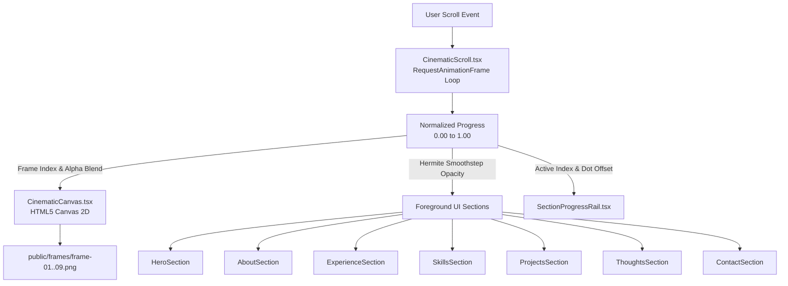

# Aayush Dubey — Cinematic Portfolio

<div align="center">

[](https://nextjs.org/)
[](https://react.dev/)
[](https://www.typescriptlang.org/)
[](https://tailwindcss.com/)
[](https://developer.mozilla.org/en-US/docs/Web/API/CanvasRenderingContext2D)
[](https://github.com/darkroomengineering/lenis)

**An interactive, scroll-driven visual journey where narrative cinematography meets real, editable software engineering.**

[Explore Overview](#-the-experience) • [Architecture](#-architecture) • [Cinematic Mechanics](#-cinematic-scroll-mechanics) • [Projects](#-featured-projects) • [Getting Started](#-getting-started)

</div>

---

## 📖 Why This Exists

Traditional developer portfolios are often static grids or generic cards that fail to convey atmosphere, momentum, or storytelling. 

This project was built to explore a fundamentally different interaction model: **the browser scrollbar as a kinetic timeline controller**. As the user scrolls, they navigate through a high-fidelity cinematic sequence while real, accessible React UI components seamlessly emerge and fade in coordination with the background environment.

```
User Scrolls
    ↓
Kinetic Scroll Progress [0.0 → 1.0]
    ↓
HTML5 Canvas Interpolates 9-Frame Sequence
    ↓
Settled UI Sections Choreographed in Lockstep
```

The background is not an inert video or looping GIF—it is a frame-precise canvas renderer synchronized directly to the user's scroll position.

---

## 🎬 The Experience

The visual journey progresses across **9 cinematic frames** that transition from a bright, illuminated architectural vista down into an evocative twilight hillside village:

```
Frame 01  ──→  Frame 02  ──→  Frame 03  ──→  Frame 04  ──→  Frame 05  ──→  Frame 06  ──→  Frame 07  ──→  Frame 08  ──→  Frame 09
(01 INTRO)      (Transition)    (02 ABOUT)    (Transition)   (03 EXPERIENCE) (04 SKILLS)   (05 PROJECTS)   (06 THOUGHTS)   (07 CONTACT)
```

- **Scroll Drives Progress**: Every pixel of scroll translates into fractional sub-frame canvas blending.
- **Bi-Directional**: Reverse scrolling seamlessly rewinds the cinematography and re-animates earlier sections.
- **State Preservation**: Stopping anywhere holds the scene in its exact visual state with sub-pixel clarity.
- **Layer Separation**: The cinematic canvas runs independently in a background stage (`z-index: 0`), while editable React components float on the foreground layer (`z-index: 10`).

---

## ✨ Key Features

- **Scroll-Driven Frame Engine**: 9-frame canvas renderer with fractional alpha cross-fading, aspect ratio cover math, and pixel-density scaling.
- **Zero React Re-render Animation Loop**: High-frequency scroll calculations run directly inside a `requestAnimationFrame` loop with direct DOM property mutation.
- **Settled Target Navigation**: Header links and the left section rail jump directly to mathematically settled progress targets with zero ghosting or blur.
- **Interactive Left Progress Rail**: Vertical tracker displaying section index (`01 INTRO` through `07 CONTACT`), a continuous hairline, and a dynamically moving marker dot.
- **Editorial Typography**: Pairing **Cormorant Garamond** display serif headings with clean **Inter** sans-serif body copy via `next/font/google`.
- **Responsive Viewport Choreography**: Independent mobile, tablet, and desktop layouts with graceful overflow scrolling on constrained screens.
- **High-DPI Support**: Automatically scales the canvas backing store to `window.devicePixelRatio` for retina-crisp rendering without blur.
- **Accessibility & Reduced Motion**: Full semantic HTML5 tags, descriptive ARIA attributes, keyboard-focusable interactive elements, and `prefers-reduced-motion` compliance.

---

## 🏗 Architecture

The application is structured into three coordinated layers:



### Component Breakdown

| Component | File Path | Responsibility |
|---|---|---|
| `CinematicScroll` | `src/app/components/CinematicScroll.tsx` | Main scroll container, RAF animation coordinator, settled target definitions, and direct DOM opacity mutator. |
| `CinematicCanvas` | `src/app/components/CinematicCanvas.tsx` | Imperative canvas renderer; handles image preloading, DPR scaling, `coverRect` aspect ratio math, and sub-frame cross-fading. |
| `SiteHeader` | `src/app/components/SiteHeader.tsx` | Fixed top navigation bar with `AD` monogram, settled section nav links, and CTA button. |
| `SectionProgressRail` | `src/app/components/SectionProgressRail.tsx` | Left vertical HUD with dynamic section counter (`01 INTRO` to `07 CONTACT`) and moving dot marker. |
| `SocialRail` | `src/app/components/SocialRail.tsx` | Fixed right vertical rail with inline SVG icons for GitHub, LinkedIn, and Email. |
| `ScrollIndicator` | `src/app/components/ScrollIndicator.tsx` | Bottom scroll hint indicator (`SCROLL TO EXPLORE ↓`) that fades automatically as the user scrolls. |
| `HeroSection` | `src/app/components/HeroSection.tsx` | Intro composition with serif typography and dual action CTAs. |
| `AboutSection` | `src/app/components/AboutSection.tsx` | 2-column layout: bio narrative & resume download on the left; structured personal info rows on the right. |
| `ExperienceSection` | `src/app/components/ExperienceSection.tsx` | 2-column layout: editorial summary on the left; continuous vertical hairline timeline with glowing dots on the right. |
| `SkillsSection` | `src/app/components/SkillsSection.tsx` | 2-column skills grid with dedicated icons, percentages, and progress bars. |
| `ProjectsSection` | `src/app/components/ProjectsSection.tsx` | 3-card project showcase with dark UI mockup previews and external links. |
| `ThoughtsSection` | `src/app/components/ThoughtsSection.tsx` | 3 editorial article rows with preview thumbnails, publication dates, and read times. |
| `ContactSection` | `src/app/components/ContactSection.tsx` | Get in touch CTA, direct email link, social profiles, and global footer bar. |

---

## ⚙️ Cinematic Scroll Mechanics

### 1. Normalized Progress Calculation

The scroll container is set to `2500vh` to provide ample physical scroll depth. On each animation frame, the normalized progress $p \in [0, 1]$ is computed:

$$p = \frac{\text{scrollY}}{\text{scrollHeight} - \text{innerHeight}}$$

### 2. Fractional Frame Blending

The progress value is mapped across the 9 frames:

$$\text{frameF} = p \times (N - 1) = p \times 8$$

$$\text{frameA} = \lfloor\text{frameF}\rfloor, \quad \text{frameB} = \min(\text{frameA} + 1, 8), \quad \alpha = \text{frameF} - \text{frameA}$$

`CinematicCanvas` paints `frameA` at full opacity and cross-fades `frameB` on top with `globalAlpha = alpha` whenever $\alpha > 0.004$, eliminating visual stepping.

### 3. Smoothstep Section Visibility & Settled Navigation

Section opacities are computed using cubic Hermite interpolation ($3t^2 - 2t^3$) across calibrated progress gates. Clicking any navigation link triggers a smooth scroll directly to its settled target progress:

| Section | Settled Target ($p$) | Active Visibility Range ($p$) |
|---|---|---|
| `01 INTRO` | `0.000` | `0.00 → 0.27` |
| `02 ABOUT` | `0.320` | `0.20 → 0.44` |
| `03 EXPERIENCE` | `0.470` | `0.36 → 0.58` |
| `04 SKILLS` | `0.605` | `0.50 → 0.72` |
| `05 PROJECTS` | `0.735` | `0.63 → 0.84` |
| `06 THOUGHTS` | `0.855` | `0.75 → 0.94` |
| `07 CONTACT` | `0.970` | `0.87 → 1.00` |

---

## 🗂 Portfolio Sections

```
01 — INTRO          Full viewport presentation, title display, and primary CTAs
02 — ABOUT          Biography, career philosophy, resume download, and verified details
03 — EXPERIENCE     Timeline of engineering roles (Freelance, TechNova Solutions, CodeCraft Labs)
04 — SKILLS         Technical stack proficiency with dual-column animated progress bars
05 — PROJECTS       Showcase of engineered platforms with custom UI mockups
06 — THOUGHTS       Written technical articles on software architecture, design, and performance
07 — CONTACT        Direct email channel, social channels, and copyright footer
```

---

## 🚀 Featured Projects

### 1. RivalXP
- **Overview**: AI-powered coaching and performance analytics platform tailored for competitive athletes.
- **Tech Stack**: Next.js, TypeScript, Tailwind CSS, WebSockets.
- **Highlights**: Real-time telemetry dashboard, workout visualization, and predictive performance metrics.
- **Link**: [View Repository](https://github.com/aayushdubey)

### 2. EIGI
- **Overview**: AI Agent orchestration platform built for intelligent workflow automation and reasoning.
- **Tech Stack**: React, Node.js, TypeScript, LLM APIs.
- **Highlights**: Multi-agent task pipelines, execution visualizer, and typed workflow engine.
- **Link**: [View Repository](https://github.com/aayushdubey)

### 3. Whitfield WMS
- **Overview**: Modern warehouse management system engineered for high-throughput inventory operations.
- **Tech Stack**: React, TypeScript, Node.js, MongoDB.
- **Highlights**: Live order dispatch, stock level tracking, and operational efficiency metrics.
- **Link**: [View Repository](https://github.com/aayushdubey)

---

## 💼 Experience & Resume Summary

- **Full Stack Developer** — *Freelance* (2023 – Present)  
  Building modern, high-performance web applications using Next.js, Node.js, and MongoDB.
- **Frontend Developer** — *TechNova Solutions* (2022 – 2023)  
  Engineered responsive interfaces and improved Core Web Vitals and load performance.
- **Web Developer Intern** — *CodeCraft Labs* (2021 – 2022)  
  Delivered client projects and adopted modern industry best practices.
- **Education**: B.Tech in Computer Science and Cybersecurity (CSCS)
- **Location**: Nagpur, India

---

## 🛠 Tech Stack

| Domain | Technologies |
|---|---|
| **Framework & Runtime** | Next.js 16.3.3 (App Router, Turbopack), React 19.2.8, React DOM 19 |
| **Languages** | TypeScript 5, JavaScript (ES2024) |
| **Styling & Design** | Tailwind CSS v4, Vanilla CSS Custom Properties, Glassmorphism |
| **Graphics & Scroll** | HTML5 Canvas 2D API, RequestAnimationFrame, Lenis Smooth Scroll (`^1.3.26`) |
| **Animation & Icons** | Motion (`^13.1.1`), Lucide React (`^1.37.0`), Custom Inline SVGs |
| **Typography** | Cormorant Garamond (Serif Display), Inter (Sans-Serif UI) |
| **Build & Tooling** | ESLint 9, React Compiler (`babel-plugin-react-compiler`) |

---

## 🎨 Design System

- **Typography Palette**:
  - Headings: `Cormorant Garamond` (`--font-serif`) — 300 / 400 / 600 weight.
  - Body & UI: `Inter` (`--font-sans`) — 400 / 500 / 600 / 700 weight.
- **Color Tokens**:
  - Background Base: `#050811` (Deep Space Navy)
  - Accent Primary: `#4da6ff` (Cyan Glow)
  - Text Primary: `#ffffff` (Pure White)
  - Text Muted: `rgba(255, 255, 255, 0.78)` / `rgba(255, 255, 255, 0.55)`
  - Glass Surface: `rgba(10, 18, 34, 0.65)` with `backdrop-filter: blur(14px)`
  - Outlined Borders: `1px solid rgba(255, 255, 255, 0.14)` to `0.40`
- **Atmosphere**: Open, continuous landscape composition with subtle dark vignettes for legible text contrast over cinematic backgrounds.

---

## ⚡ Performance & UX Decisions

1. **Direct Canvas 2D Blending**: Eliminates heavy DOM image trees and CSS filter lag by offloading frame interpolation to an optimized HTML5 2D canvas.
2. **`coverRect` Centering Math**: Custom math calculates exact source crop rectangles on the fly, matching CSS `object-fit: cover` with zero distortion or image scaling overhead.
3. **No State Thrashing**: High-frequency scroll ticks (60–120 Hz) mutate element styles directly via `ref.current.style`, preventing thousands of unnecessary React re-renders.
4. **Asset Preloading**: All 9 frame assets are instantiated and cached on mount, guaranteeing stutter-free cross-fades during rapid user scrolling.
5. **DPR Clamping**: Handles high-density retina displays by multiplying physical canvas buffer dimensions by `window.devicePixelRatio`.

---

## ♿ Accessibility

- **Semantic Landmark Roles**: `<main>`, `<header>`, `<footer>`, `<article>`, and `role="list"` structures throughout.
- **Screen Reader Context**: Descriptive `aria-label` tags on all icon-only buttons, social links, and external references.
- **Reduced Motion Support**: Dedicated `@media (prefers-reduced-motion: reduce)` block that disables non-essential transitions and animations.
- **Contrast & Hierarchy**: Strong text shadow drop filters ensure readability across varying light intensities in the cinematic scenes.

---

## 📁 Project Structure

```
portfolio-site/
├── public/
│   ├── frames/
│   │   ├── frame-01.png       # Scene 1: Illuminated architectural vista
│   │   ├── frame-02.png       # Scene 2
│   │   ├── frame-03.png       # Scene 3: Hillside transition
│   │   ├── frame-04.png       # Scene 4
│   │   ├── frame-05.png       # Scene 5: Riverbank evening view
│   │   ├── frame-06.png       # Scene 6
│   │   ├── frame-07.png       # Scene 7: Twilight village
│   │   ├── frame-08.png       # Scene 8
│   │   └── frame-09.png       # Scene 9: Deep night lighting
│   ├── favicon.ico
│   └── resume.pdf
├── src/
│   └── app/
│       ├── components/
│       │   ├── AboutSection.tsx           # 02 About UI
│       │   ├── CinematicCanvas.tsx        # HTML5 Canvas 2D renderer
│       │   ├── CinematicScroll.tsx        # Scroll engine & RAF loop
│       │   ├── ContactSection.tsx         # 07 Contact UI & Footer
│       │   ├── ExperienceSection.tsx      # 03 Experience Timeline UI
│       │   ├── HeroSection.tsx            # 01 Intro Hero UI
│       │   ├── ProjectsSection.tsx        # 05 Featured Projects UI
│       │   ├── ScrollIndicator.tsx        # Bottom scroll hint indicator
│       │   ├── SectionProgressRail.tsx    # Left dynamic progress rail
│       │   ├── SiteHeader.tsx             # Top navigation bar
│       │   ├── SkillsSection.tsx          # 04 Skills & Progress Bars UI
│       │   ├── SocialRail.tsx             # Right vertical social rail
│       │   └── ThoughtsSection.tsx        # 06 Articles & Thoughts UI
│       ├── globals.css                    # Design system, layout & tokens
│       ├── layout.tsx                     # Root layout with Google Fonts
│       └── page.tsx                       # Main entry point
├── package.json
├── tsconfig.json
├── next.config.ts
└── README.md
```

---

## 🚦 Getting Started

### Prerequisites

- **Node.js**: `v18.17.0` or higher (Node.js 20+ recommended)
- **Package Manager**: `npm` (or `pnpm` / `yarn`)

### Installation

1. **Clone the repository**:
   ```bash
   git clone https://github.com/aayushdubey/portfolio-site.git
   cd portfolio-site
   ```

2. **Install dependencies**:
   ```bash
   npm install
   ```

3. **Start the local development server**:
   ```bash
   npm run dev
   ```

4. **Open in browser**:
   Navigate to [http://localhost:3000](http://localhost:3000).

### Available Scripts

| Command | Description |
|---|---|
| `npm run dev` | Starts Next.js development server with Turbopack |
| `npm run build` | Compiles an optimized production build |
| `npm run start` | Runs the compiled production server |
| `npm run lint` | Runs ESLint checks across the codebase |

---

## 🔧 Configuration

All configurable content is organized directly within typed TypeScript components:

- **Section Progress Timing & Settled Targets**: Configured in `src/app/components/CinematicScroll.tsx` (`SECTION_TIMING`, `SECTION_SETTLED_TARGETS`).
- **Cinematic Frames**: Asset paths and frame counts configured in `src/app/components/CinematicCanvas.tsx` (`FRAME_COUNT`, `FRAME_SRCS`).
- **Resume Data**: Located in `src/app/components/AboutSection.tsx` and `src/app/components/ExperienceSection.tsx`.
- **Project Showcase**: Located in `src/app/components/ProjectsSection.tsx` (`PROJECTS_DATA`).
- **Social Links & Email**: Configured across `SiteHeader.tsx`, `SocialRail.tsx`, and `ContactSection.tsx`.

---

## 🚢 Deployment

This project is optimized for deployment on **Vercel**:

1. Push your changes to GitHub.
2. Import the repository into your [Vercel Dashboard](https://vercel.com/new).
3. Next.js App Router and static page generation are automatically detected.
4. Deploy with zero additional configuration needed.

To test the production build locally before deploying:
```bash
npm run build
npm run start
```

---

## 🛠 Engineering Principles

When contributing or extending this codebase:

1. **Single Source of Truth**: The scroll engine in `CinematicScroll.tsx` is the sole coordinator of scroll progress. Do not introduce competing scroll listeners or duplicate animation loops.
2. **Separation of Layers**: Keep the canvas rendering layer completely separated from editable UI components. Avoid embedding text or icons into static frame images.
3. **Preserve Settled Targets**: When modifying section timing in `SECTION_TIMING`, ensure `SECTION_SETTLED_TARGETS` is updated to a progress value where the active section is 100% opaque and adjacent sections are 0% opaque.
4. **Direct Ref Mutation**: Mutate DOM element properties (`opacity`, `transform`, `pointerEvents`) inside the RAF loop rather than triggering React state updates.

---

## 🗺 Project Roadmap

- [x] **Phase 1: Cinematic Scroll Engine & Canvas Renderer**
  - [x] 9-frame canvas interpolation pipeline with sub-frame alpha blending
  - [x] Fixed viewport stage and DPR scaling
  - [x] Zero-latency RAF scroll loop
  - [x] Mathematical settled navigation targeting
- [x] **Phase 2: Portfolio Interface Layer**
  - [x] Top header navigation with monogram and CTA
  - [x] Left vertical section rail with active dot tracker
  - [x] Right vertical social rail & bottom scroll indicator
  - [x] Editorial Hero section (`01 INTRO`)
  - [x] Verified resume data & About section (`02 ABOUT`)
  - [x] Hairline timeline & Experience section (`03 EXPERIENCE`)
  - [x] Two-column progress bars & Skills section (`04 SKILLS`)
  - [x] Dark UI mockup cards & Featured Projects section (`05 PROJECTS`)
  - [x] Editorial articles & Thoughts section (`06 THOUGHTS`)
  - [x] Contact section & Global Footer (`07 CONTACT`)
- [ ] **Phase 3: Planned Enhancements**
  - [ ] WebGL shader transition options between key cinematic scenes
  - [ ] Dynamic RSS / CMS feed integration for the Thoughts section

---

## 📬 Contact & Connect

**Aayush Dubey**  
Full Stack Developer • Nagpur, India

- **Email**: [aayushdubey2300@gmail.com](mailto:aayushdubey2300@gmail.com)
- **GitHub**: [@aayushdubey](https://github.com/aayushdubey)
- **LinkedIn**: [Aayush Dubey](https://linkedin.com/in/aayushdubey)
- **Instagram**: [@aayushdubey](https://instagram.com/aayushdubey)

---

<div align="center">

*Engineered with precision, passion, and storytelling.*

© 2025 Aayush Dubey. All rights reserved.

</div>
